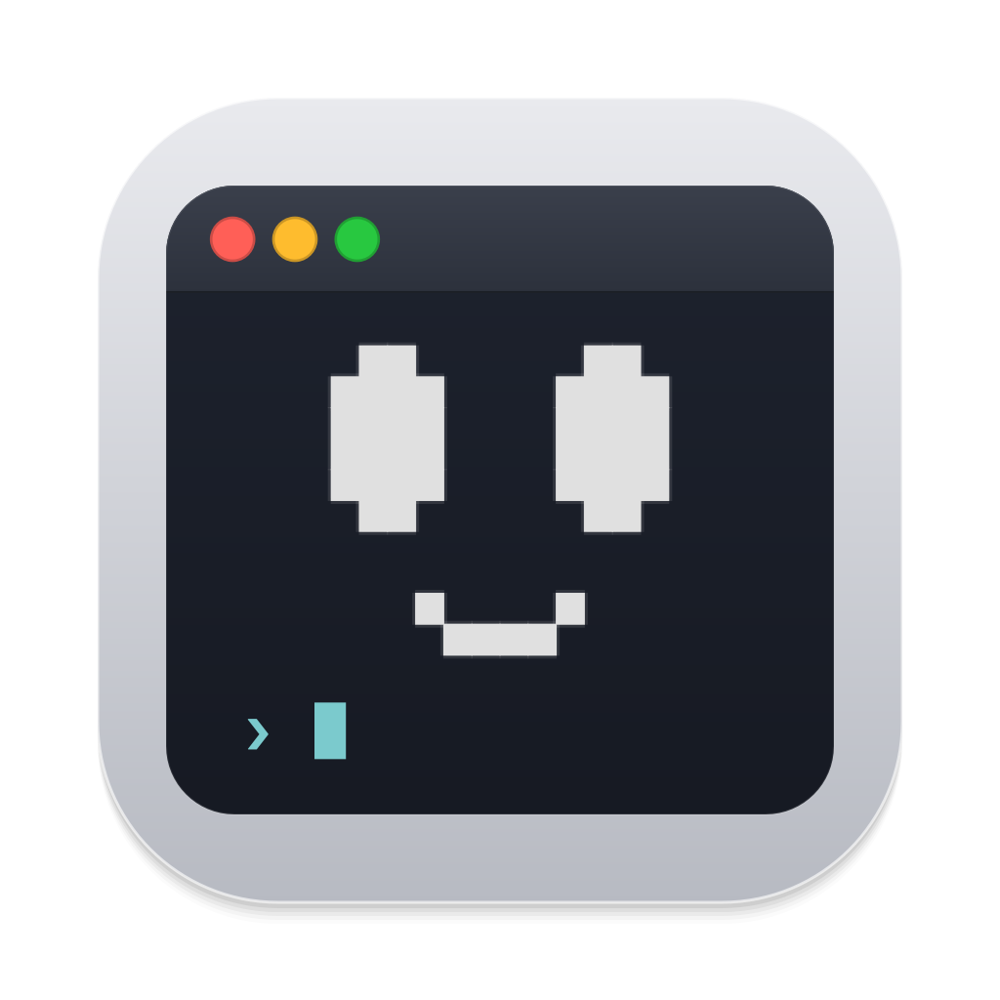

<div align="center">



# A11y

**An desktop accessibility companion with floating desktop presence, computer use, and strict local privacy**

   
    

</div>

---

## Overview

No mock scripts, no fake demo responses — A11y is a privacy-first desktop accessibility companion built for the accessibility hackathon. At its core sits a floating, frameless vector mascot that lives unobtrusively on your desktop, paired with a unified Python application service and a real, schema-validated LLM transport (via local Ollama or opt-in Claude).

A11y validates proposed actions locally and asks for confirmation before sensitive changes:
- **Desktop awareness & computer use** — inspects window hierarchies and UI controls via native OS bridges (macOS Accessibility APIs and Windows Win32), executing bounded navigation actions and pausing for review of sensitive changes.
- **Visual grounding** — takes transient, on-demand screenshots through ScreenCaptureKit to resolve spatial targets, verifying pixel geometry and window hashes before any click is dispatched.

---

## Architecture & Subsystems

| Subsystem | Platform | Implementation Details |
|---|---|---|
| **Mascot Companion** | Cross-platform (PyQt6) | Frameless, transparent floating widget (`Mascot`) with speech balloon, multiline composer (`Enter` to submit, `Shift+Enter` for newline), collapse-to-mascot state. |
| **macOS Desktop Bridge** | macOS 14+ (Swift) | `DesktopBridge.swift` compiled dynamically via `xcrun swiftc`. Inspects active applications, focused window titles, and accessible UI element trees using `AXUIElement`. Supports window focusing, quitting, and Terminal `⌘N`. |
| **Windows Desktop Bridge** | Windows 10/11 (Win32) | `companion/windows_desktop.py` interacts directly with Win32 APIs via `ctypes`. Queries top-level windows, enumerates Start Menu applications, resolves system utilities (Settings, Notepad, Calculator), and manages window states. |
| **Visual Perception & Clicks** | macOS 14+ | `ScreenVision` captures display buffers via ScreenCaptureKit. Computes normalized coordinates, highlights targets with expiring desktop rings, and enforces click guards (sampling pixels around targets to abort on screen shifts). |
| **Computer Task Engine** | Cross-platform / Native | Multi-step perception-action loop (`ComputerTask`) capped at 24 actions. Observes application context, proposes atomic operations (clicks, text input, navigation keys, scrolling), and automatically pauses before destructive actions. |
| **Instance Locking** | Win32 / POSIX | Single-instance process lock (`DesktopInstance`) preventing split-brain database corruption using `msvcrt.locking` on Windows and `fcntl.flock` on UNIX. Rejects duplicate launches with active PID diagnostics. |

---

## Platform Support

| Capability | macOS (Sonoma+) | Windows (10/11) | Linux / WSL2 |
|---|---|---|---|
| **Floating Mascot Companion** | Native transparent window | Native transparent window | Wayland / X11 |
| **Active App & Window Awareness** | Swift Accessibility Bridge | Win32 ctypes bridge | — |
| **Window Actions (Focus / Close / Quit)** | Full (`AXUIElement`) | Full (Win32 messages) | — |
| **Start-Menu / App Launching** | LaunchServices | Windows Start Catalog / Run | — |
| **Screen Vision & Coordinate Clicks** | ScreenCaptureKit + guarded clicks, Vision OCR | GDI capture, Windows OCR, guarded SendInput clicks (not yet verified on hardware) | — |
| **Autonomous Computer Tasks** | Screenshot/action loop | Screenshot/action loop with UI Automation, typing and keys (not yet verified on hardware) | — |
| **Text-to-Speech (TTS)** | Qt `QTextToSpeech` | Qt `QTextToSpeech` / SAPI | Speech Dispatcher |
| **Voice Input (STT)** | "Hey Ally" (local faster-whisper) | "Hey Ally" (local faster-whisper) | — |
| **Built-in apps in code** | Mail, Calendar, Reminders, Notes, Contacts, Finder, browser page, Shortcuts | — | — |

---

## Features

Settings → Preferences offers explicit explanation length, pacing, keyboard navigation and reduced motion choices.

- **Mascot-first interaction** — The app launches into a compact, floating desktop mascot that stays anchored in the corner of your workspace. Left-click toggles the pill-shaped prompt composer; drag anywhere to reposition.
- **Autonomous computer tasks** — Right-click the companion → **Computer task…** to delegate multi-step goals. The assistant captures the display, selects a structured action (clicking, typing, scrolling, launching apps), executes it, and re-evaluates progress—capped at 24 actions with a hard interrupt shortcut (`⌘.` / **Stop task**).
- **Action review** — Ordinary navigation clicks and requested local drafting can run in the task loop. Sending, submitting, deleting, closing, and other sensitive changes pause for review. Fresh visual targets or native control IDs bind execution to the observed interface.
- **Screen vision with click guards** — Request-time display analysis captures a fresh frame via ScreenCaptureKit. Before clicking, A11y re-samples a bounding box around the target; if the underlying window shifted or changed, the click is refused.
- **Prompt-only bar & speech balloon** — Normal conversation takes place in a minimalist 240px wide input bar. Replies appear in an auto-sizing speech balloon overhead with text-to-speech support and accessible contrast.
- **Hands-free voice ("Hey Ally")** — Right-click the companion → **Turn on voice**. Say "Hey Ally" (or "Hey Ally, open Teams"), then talk naturally: every spoken request takes exactly the same path as typed text, replies are read aloud in a natural local voice (Kokoro “Heart”, open weights, downloaded once when voice is turned on; `A11Y_VOICE` selects another Kokoro voice) or the system voice when it is unavailable, and confirmations accept "yes" / "no". After a reply A11y listens again for 8 s; "goodbye", silence or a finished task returns to waiting for "Hey Ally". `Ctrl+Shift+Space` starts a conversation from the keyboard. Speech is recognized locally with faster-whisper (`tiny.en` for the wake phrase, `small.en` for requests); audio is never saved or sent anywhere (only the recognized text, like typed text, goes to the AI you chose), and the microphone pauses while A11y speaks or works and for a moment after it stops talking.
- **Built-in Mac apps, done in code** — Ask in your own words: “read out my last email”, “what's on my calendar tomorrow”, “what do I have to do today”, “read my trip note”, “what's Ana's number”, “what did I download last”, “summarize this page”, “run my morning shortcut”. The local model only works out what you want; A11y then reads the exact data from Mail, Calendar and Reminders (EventKit, recurring events included), Notes, Contacts, your Downloads/Desktop/Documents folders, the browser's current tab and Shortcuts. Nothing is screenshotted, and emails are not sent to a model or saved in History. Changes (adding an event, reminder or note, ticking off a reminder, running a shortcut) are shown as a button and happen only when you press it or say “yes”.
- **Multi-instance locking** — A process-lifetime lock in `%LOCALAPPDATA%\A11y` or `.data/` guarantees only one instance touches the SQLite stores at a time, displaying the active PID and git build ID if a collision occurs.

---

## Install the App

Download the latest build from the repository's **Actions → Package apps** run (artifacts) or from a
tagged **Release**:

- **macOS 14+ (Apple Silicon):** open `A11y-macOS.dmg`, drag **A11y** to Applications. Builds without a
  Developer ID are ad-hoc signed, so the first launch needs **right-click → Open** (or System Settings →
  Privacy & Security → Open Anyway).
- **Windows 10/11:** unzip `A11y-Windows.zip` and run `A11y\A11y.exe`.

On first launch, **Get A11y ready** offers to install everything that is missing, only after you press
**Set up**: Ollama (downloaded from ollama.com, signature verified before use) and two local models
chosen for your RAM (`qwen3:4b-instruct` + `qwen3-vl:4b-instruct` on 16 GB or more, smaller models
below), plus the voice models (Whisper speech recognition and, on macOS, the natural Kokoro voice).
Reopen it any time from the mascot's right-click menu → **Set up AI and voice…**.

macOS asks for permissions as features need them: Accessibility (app awareness and clicking), Screen
Recording (screen vision), Microphone (voice), Calendars and Reminders, Automation (Mail, Notes,
Contacts, Music and your browser) and file access (Downloads, Desktop, Documents). Unsigned builds
count as a new app after every update, so macOS may ask again; A11y clears its stale Accessibility
entry and re-prompts when clicking is blocked. To keep permissions across updates, run
`packaging/make_signing_certificate.sh` once and add its two values as the `MACOS_SIGNING_P12` and
`MACOS_SIGNING_PASSWORD` repository secrets: every build is then signed with the same identity. Settings, data and the
log live in `~/Library/Application Support/A11y` (`%LOCALAPPDATA%\A11y` on Windows); the log is `a11y.log`.

**Build it yourself:** `packaging/build_macos.sh` on a Mac (needs Xcode Command Line Tools for the
Swift helpers) or `packaging/build_windows.ps1` on Windows; output goes to `dist/`. To use your own
icon artwork, save it as `packaging/icon-source.png` before building. The `Package apps` workflow
builds both on every push to `main` and runs each packaged app's `--self-test` (HTTPS, voice, the Claude SDK,
helpers, permissions strings) before anything is published. To publish a release, run the workflow
from **Actions → Package apps → Run workflow** with a version such as `v1.0.0` (or push a `v*` tag). Optional secrets
`MACOS_SIGN_IDENTITY`, `APPLE_ID`, `APPLE_TEAM_ID` and `APPLE_APP_PASSWORD` enable Developer ID
signing and notarization.

## Run & Setup

Python 3.10+ is required.

Opening or focusing an installed app starts immediately. Closing and quitting require
review. Follow-up work and direct click requests enter the screenshot/action loop. A request
such as "open teams" matches "Microsoft Teams" when exactly one installed app fits.

### Windows

Run natively with Windows Python (WSLg cannot composite frameless transparent windows properly):

1. Install Python 3.12 (if not already installed):
   ```cmd
   winget install Python.Python.3.12 --scope user
   ```
2. Double-click `run_windows.bat` or run from Command Prompt / PowerShell:
   ```cmd
   run_windows.bat --panel
   ```
   *On first launch, the batch script detects Python, initializes a dedicated virtual environment in `%USERPROFILE%\.venvs\a11y`, and installs `requirements.txt` plus the optional voice packages (`requirements-voice.txt`). Data is kept locally in `%LOCALAPPDATA%\A11y`. The first time voice is turned on, the speech models (about 550 MB) are downloaded once. Windows must allow desktop apps to use the microphone (Settings → Privacy & security → Microphone).*

**Ollama on Windows: run it natively, not in WSL.** WSL gets only part of the RAM and no GPU; on a
Ryzen 7 8840HS laptop the model was CPU-only, read prompts at ~67 tokens/s and was OOM-killed. Native
Ollama for Windows with the Radeon 780M via Vulkan read prompts at 175–245 tokens/s (930+ with its prompt
cache), so a chat reply takes seconds instead of minutes. Integrated GPUs are opt-in:
```cmd
winget install Ollama.Ollama
setx OLLAMA_IGPU_ENABLE 1
```
Stop any Ollama inside WSL first (`sudo systemctl disable --now ollama`), because both use port 11434.
A11y keeps the model loaded for 30 minutes (`A11Y_OLLAMA_KEEP_ALIVE`) and pre-reads its instructions at
startup, so the first request is warm.

### macOS

1. Ensure Xcode Command Line Tools are installed (needed for the Swift bridge):
   ```bash
   xcode-select --install
   ```
2. Create virtual environment and install dependencies:
   ```bash
   python3 -m venv .venv
   .venv/bin/python -m pip install -r requirements.txt
   .venv/bin/python -m pip install -r requirements-voice.txt   # optional: "Hey Ally" voice
   ```
3. Launch the desktop companion:
   ```bash
   .venv/bin/python a11y_desktop.py
   ```
   *Grant macOS Accessibility and Screen Recording permissions when prompted, and Microphone access when voice is turned on.*

### Linux / WSL2

```bash
python3 -m venv .venv
.venv/bin/python -m pip install -r requirements.txt
.venv/bin/python a11y_desktop.py --panel
```

## AI Configuration

A11y supports local Ollama inference out of the box with zero cloud leakage, Claude Sonnet through the Anthropic API as an opt-in.

### Local Ollama (Default)

1. Start the Ollama daemon:
   ```bash
   ollama serve
   ```
2. Pull a recommended model:
   ```bash
   # Text and task planning
   ollama pull qwen3.5:9b

   # Multimodal screen vision
   ollama pull qwen3-vl:8b-instruct
   ```
3. A11y scans installed models automatically in **Settings → AI connection → Find local Ollama models**.

### Claude Sonnet (opt-in, cloud)

For sharper routing and more reliable on-screen tasks, use Claude Sonnet 5.5
(`claude-sonnet-5-5`) instead of the local model: **Settings → Advanced → AI model**, paste an
Anthropic API key, and choose **Use Claude**. **Forget Claude key** switches back to the local model.

- **What is sent to Anthropic:** your requests, recent conversation, app and window names. A11y asks once before the first switch.
- **Screen images** are sent only after you allow screen vision *for Claude*; allowing it for the
  local model does not count. Password fields and protected apps are never captured.
- **Stays on your computer:** Mail, Calendar, Reminders, Notes and Contacts are read in code and
  shown directly, without the model. Every action still goes through the same local validation,
  access checks and confirmations as with Ollama.
- **The key** is saved only on this computer, in A11y's data folder (`anthropic-key`, readable only
  by your user). `ANTHROPIC_API_KEY` in the environment takes precedence; `A11Y_AI_PROVIDER=claude`
  selects Claude without the settings window.
- Use a normal API key (`sk-ant-api…`, console.anthropic.com → API keys). A user key (`sk-ant-usr-…`) has no
  workspace; for one, also fill in the Workspace ID field (or `ANTHROPIC_WORKSPACE_ID`).
- Routing and chat run at low effort for speed; screen steps run at medium. Override with
  `A11Y_CLAUDE_EFFORT=low|medium|high`. Refusals in some categories retry on another Claude model
  inside the same request (Anthropic's server-side fallback).

## Controls & Keybindings

| Shortcut / Gesture | Target | Action |
|---|---|---|
| **Left Click** | Mascot | Toggle compact prompt input bar / Read latest reply |
| **Click + Drag** | Mascot | Reposition companion across the desktop |
| `Alt` + **Arrow Keys** | Mascot | Move companion to screen edges / corners |
| `Enter` | Prompt Composer | Submit query or command |
| `Shift` + `Enter` | Prompt Composer | Insert newline |
| `Escape` | Prompt / Balloon | Collapse back to idle companion icon |
| **Right Click** / `Shift` + `F10` | Mascot | Open context menu (Screen vision, Computer task, Settings, Quit) |
| `⌘.` / **Stop Task** | Desktop | Instantly interrupt active autonomous computer task |
| `F5` / **Settings → Panel** | Desktop | Open full settings panel |

---

## Where Things Live

```
.data/   (default; run_windows.bat selects %LOCALAPPDATA%\A11y)
├── employee.sqlite3           # Reviewed profile, explicit preferences, access consent and history
├── desktop-instance.lock      # Process lock holding active PID and build hash
├── ai.json                    # Chosen provider and local models
├── anthropic-key              # Only if you use Claude (owner read/write only)
└── swift-cache/               # Cached compilation artifacts for DesktopBridge.swift
```

- **Transient In-Memory Data**: Screenshot buffers, ScreenCaptureKit frames, window hierarchy snapshots, and API keys (except the Claude key you chose to save) are kept strictly in volatile memory and are cleared on task completion or pause.
- **Repository Data**: When running in development mode, databases default to `.data/` unless overridden via `A11Y_DATA_DIR`.

---

## Verification & Tests

A11y includes an automated test suite exercising core service state machines, schema validators, HTTP transports, and Qt widgets in headless offscreen mode:

```bash
# Run full Python test suite
.venv/bin/python -m unittest discover -s tests -v

# Verify Python syntax and compilation
python3 -m compileall -q a11y_desktop.py companion scripts
```

Tests cover the shared service, explicit preferences, request routing, native bridge contracts,
Ollama transport, guarded clicks, task cancellation and Qt controls. Platform calls
and model responses are doubled in automated tests; they do not establish live
Windows compatibility or local-model targeting accuracy.

### Benchmark Evaluators

Standalone scripts under `scripts/` evaluate model grounding without desktop side-effects:

```bash
# Evaluate spatial movement targeting against synthetic SVG scenes
.venv/bin/python scripts/evaluate_movement.py --model qwen3.5:9b

# Evaluate application intent routing against synthetic window states
.venv/bin/python scripts/evaluate_app_actions.py --model qwen3.5:9b

# Evaluate 5-step multi-turn computer task planning
.venv/bin/python scripts/evaluate_computer_tasks.py --model qwen3.5:9b
```
